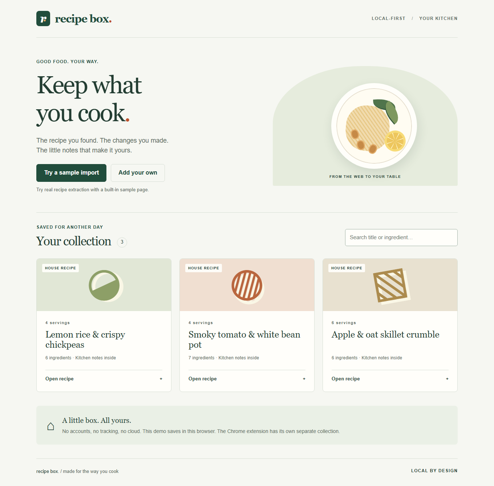

# Recipe Box

**Keep the recipe you actually cooked.** Import a recipe, correct the details, scale the ingredients, and save the notes that make it yours. A local-first Vue 3 app and Manifest V3 Chrome extension share the same editor, collection, importer, and scaler.

**[Open the live Recipe Box demo](https://corey-farr.github.io/recipe-box/)** and choose **Try a sample import**. No account, API keys, or installation needed. [Download the Chrome extension](https://github.com/Corey-Farr/recipe-box/releases/tag/v1.0.0) for importing recipes from other websites.

To run locally, install Node.js 22.13+ (24 LTS recommended), run `npm ci` then `npm run dev`, and open **http://127.0.0.1:5173**.



[Install the packaged extension](#chrome-extension) · [Watch the short demo](docs/media/demo.webm) · [Portfolio and resume copy](docs/portfolio.md) · [Interview notes](docs/interview.md)

## What you can try

- Import the local fixture through the actual JSON-LD importer. Select a recipe, change the title or ingredients, and review before saving.
- Search saved recipes by title or ingredient. Edit the recipe and reopen it after a reload.
- Change four servings to six: `1½ cups rice` becomes `2¼ cups rice`. Check ingredients and directions as you cook.
- Keep a personal note, then start a fresh cooking session. Checkmarks clear; notes and original quantities remain.
- In the extension, import any accessible recipe page with the toolbar button. If metadata is missing, fill in the same preview manually with the original URL retained.

The web demo seeds three original recipes once. The extension starts empty. **Each browser origin and the installed extension have separate local collections.** There is no sync between them.

## Setup and commands

Use a fresh checkout and a terminal in its root. Node.js 22.13+ and npm are required. The lockfile pins the tested dependency graph.

```sh
npm ci
npm run dev
```

| Command                           | Purpose                                                                      |
| --------------------------------- | ---------------------------------------------------------------------------- |
| `npm run dev`                     | Local Vite development server at http://127.0.0.1:5173                       |
| `npm run typecheck`               | Strict TypeScript and Vue template checks                                    |
| `npm run lint`                    | ESLint, with warnings treated as failures                                    |
| `npm test`                        | Vitest domain and component tests                                            |
| `npx playwright install chromium` | Install the pinned browser for end-to-end tests                              |
| `npm run build`                   | Both production builds: `dist/web` and `dist/extension`                      |
| `npm run package`                 | Package the built extension as `release/recipe-box-1.0.0.zip`                |
| `npm run test:e2e`                | Production web and packaged-extension browser tests; build and package first |
| `npm run check`                   | Typecheck, lint, unit tests, both builds, package, and browser tests         |
| `npm run preview`                 | Serve the production web build at http://127.0.0.1:4173                      |
| `npm run format`                  | Format source and documentation with Prettier                                |
| `npm run format:check`            | Check formatting without changing files                                      |

For the full release check:

```sh
npm ci
npx playwright install chromium
npm run check
```

On Linux, use `npx playwright install --with-deps chromium` to install browser system dependencies as well. End-to-end tests start their own production server on port 4173. Stop another service on that port before running them; locally, an existing Recipe Box server can be reused.

## Chrome extension

1. Download or locate [recipe-box-1.0.0.zip](https://github.com/Corey-Farr/recipe-box/releases/download/v1.0.0/recipe-box-1.0.0.zip). Extract it into a permanent folder. The extracted root must contain `manifest.json`, `background.js`, `index.html`, and `assets/`.
2. Open `chrome://extensions` in Chrome and enable **Developer mode**.
3. Choose **Load unpacked** and select that extracted root folder. Pin Recipe Box from the Extensions menu.
4. Open [the public recipe fixture](https://corey-farr.github.io/recipe-box/fixtures/recipes.html) in **Chrome**, with the fixture tab active.
5. Click Recipe Box in Chrome’s toolbar. A full-tab import preview opens. Pick a recipe, review it, and choose **Save recipe**.
6. Use **All recipes** to browse the extension collection. Bookmark that extension page if you want direct access. The toolbar always starts a new import from the current tab.

Try [the manual fallback fixture](https://corey-farr.github.io/recipe-box/fixtures/manual.html) next. Chrome’s internal pages and the Chrome Web Store cannot be imported; the app explains the restriction and keeps manual entry available.

The preview intentionally opens in a regular tab rather than a transient toolbar popup, so clicking elsewhere does not discard an unsaved draft. Closing or reloading that editor tab still discards an unsaved draft. Updating an unpacked installation: rebuild and package, replace the extracted files, then click **Reload** on the extension card. Keep the same folder and extension identity to retain its local collection.

## Static deployment

The demo is deployed on [GitHub Pages](https://corey-farr.github.io/recipe-box/). The extension ZIP is published in [GitHub Releases](https://github.com/Corey-Farr/recipe-box/releases/tag/v1.0.0); it is installed unpacked and is not listed in the Chrome Web Store. The instructions below also support deploying your own copy.

```sh
npm ci
npm run build:web
npm run preview
```

Deploy the **contents of `dist/web/`**, including `assets/` and `fixtures/`, to a static HTTPS host. For a host connected to your repository, set build command to `npm ci && npm run build:web`, publish directory to `dist/web`, and Node version to 24. No environment secrets, server runtime, or API service is needed. Do not deploy the repository root or extension build.

For a manual upload host, build locally, then upload `dist/web/` as the site directory. Open the assigned HTTPS URL and verify **Try a sample import**, save, and reload. Saved recipes are browser-local to that URL; changing the host or hostname creates a different collection.

For **GitHub Pages**, a manual-only workflow is included at [`.github/workflows/deploy-pages.yml`](.github/workflows/deploy-pages.yml):

1. Push the repository to your own GitHub repository when you are ready to publish it.
2. Under **Settings → Pages**, set **Source** to **GitHub Actions**.
3. Open **Actions → Deploy Recipe Box demo → Run workflow** on the desired branch.
4. The workflow’s deployment environment reports the Pages URL. For this repository, it is https://corey-farr.github.io/recipe-box/. Rerun the workflow after application changes to update the live demo.

Vite uses relative asset paths (`base: './'`). Browser tests serve the production build at `/recipe-box/` and exercise the sample import there. Use the trailing slash on a subdirectory URL. The app does not use client-side route paths, so no SPA rewrite rule is necessary.

## Architecture

```text
extension/background.js     Toolbar action captures tab identity, opens editor
src/platform/extension.ts   Chrome tab access and user-initiated script extraction
src/platform/storage.ts     Validated, versioned localStorage collection
src/domain/                 Recipe model, JSON-LD normalization, quantity scaling
src/components/RecipeEditor.vue  Isolated draft, validation, section editing
src/App.vue                 Shared collection, cooking view and save orchestration
public/fixtures/            Deterministic recipe and manual-fallback HTML pages
tests/unit/                 Domain, persistence and component failure tests
tests/e2e/                  Production web journeys and actual extension integration
scripts/                    Build finalization, zip packaging, static test server
```

Vite produces two builds of the same application. The `extension` mode selects the small Chrome boundary; the ordinary browser build requires no Chrome APIs. The extension uses a minimal service worker for the toolbar action and opens the Vue editor with the originating tab ID. Its script injection reads only JSON-LD text and the current URL.

The editor clones the recipe into a draft. Cancel never writes storage. Save validates the draft and writes the collection before updating UI state. Storage failures leave the draft visible. Each save reads the latest collection and merges changed records, avoiding lost additions from another open tab. Simultaneous edits to the same recipe are last-save-wins; this is not a transactional multi-user database.

Serving counts and cooking checkmarks are view state, separate from saved ingredients. Personal notes are saved explicitly. Reloading or reopening starts fresh cooking progress and the original yield. Demo seed data is written only when the collection key is absent; returning edits and an existing empty collection are respected.

## Import and scaling support

JSON-LD can be a top-level `Recipe`, an array, or a recipe in `@graph`. Type arrays and full schema type URLs are accepted. Malformed blocks are skipped independently. Multiple recipes produce a selector. Ingredients retain order. Instruction strings, `HowToStep` entries, and `HowToSection` groups retain step order and section titles. An incomplete but meaningful recipe is editable; empty metadata falls back to manual entry.

The editor represents section titles as lines beginning with `# `, followed by one direction per line. Imported values are rendered as text, never as HTML.

| Original ingredient          | Change         | Display                      |
| ---------------------------- | -------------- | ---------------------------- |
| `1½ cups rice`               | 4 → 6 servings | `2¼ cups rice`               |
| `1 1/2 cups rice`            | 4 → 6          | `2¼ cups rice`               |
| `1.5 cups rice`              | 4 → 6          | `2¼ cups rice`               |
| `1/2 teaspoon salt`          | double         | `1 teaspoon salt`            |
| `1–2 teaspoons paprika`      | double         | `2–4 teaspoons paprika`      |
| `2 (14 oz) cans of tomatoes` | double         | `4 (14 oz) cans of tomatoes` |
| `salt to taste`              | any            | unchanged                    |

The scaler recognizes leading integers, decimals, simple fractions, mixed numbers, Unicode fractions, and ranges with hyphen, en/em dash, or `to`. It only scales the leading quantity or range, preserving package sizes. Common fractions display as Unicode; other results round to three decimal places. Returning to the original serving count returns the exact original text. It does not convert units or pluralize them.

Unambiguous numeric serving yields are inferred. For `1 loaf`, `24 cookies`, or `4–6 servings`, enter **Baseline servings** before scaling. Unrecognized or invalid quantities remain unchanged instead of being guessed. Quantities embedded in directions are not scaled; the cooking view calls this out.

## Permissions and privacy

The production extension requests **only `activeTab` and `scripting`**. There are no persistent host permissions, remote services, analytics, accounts, or background crawling. The toolbar action grants temporary access to the tab you chose. Imported source links open only HTTP(S) URLs in a new tab with `noopener noreferrer`.

Recipes and notes are stored in `localStorage` under `recipe-box.v1`, scoped to the demo origin or extension origin. No `storage` permission is required for this browser API. Browser storage is not encrypted backup: clearing site data, deleting the browser profile, or uninstalling the extension can remove the collection. Export, cloud backup, and synchronization are outside this release’s scope. The manifest’s public key stabilizes the unpacked extension ID; it is public identity material, not a credential.

## Verification and showcase

The [verification record](docs/verification.md) distinguishes local runs from checks requiring external access. CI runs the repeatable checks on pushes and pull requests, and retains build and test artifacts. [Remote CI passed](https://github.com/Corey-Farr/recipe-box/actions/runs/45448686851) for the published application commit.

The extension test extracts the **versioned release zip** into a fresh temporary directory, checks its root manifest, loads it in real Chromium, and triggers the browser extension action. It does not modify permissions or provide pre-extracted recipe data. See the [interview note](docs/interview.md) for the exact boundary.

Screenshots from the working app:

- [Collection](docs/screenshots/collection.png)
- [Import preview](docs/screenshots/import-preview.png)
- [Mobile cooking view](docs/screenshots/mobile-cooking.png)

[Short demo recording](docs/media/demo.webm) · [60-second live walkthrough](docs/walkthrough.md) · [Portfolio and resume copy](docs/portfolio.md)

To refresh screenshots and the paced recording after building, run:

```powershell
$env:CAPTURE_DOCS='1'
npx playwright test tests/e2e/web.spec.ts --grep "capture showcase"
Remove-Item Env:CAPTURE_DOCS
```

On macOS/Linux: `CAPTURE_DOCS=1 npx playwright test tests/e2e/web.spec.ts --grep "capture showcase"`. Ordinary test runs put their capture artifacts in ignored `test-results/` rather than overwriting showcase files.

## Known limits and attribution

- JSON-LD only; no arbitrary visual-page scraper, microdata parser, iframe traversal, OCR, or remote URL proxy. Missing/unsupported metadata can be entered manually.
- Nested instruction sections use `Parent / Child` headings to retain their hierarchy in the editor. HTML embedded in metadata remains literal text for review.
- The web demo’s import button reads a bundled fixture. Importing an arbitrary site requires the installed extension; the web app cannot read other browser tabs.
- Browser tests use pinned Chromium on desktop and emulated phone widths. They do not establish Safari, Firefox, physical-device, or screen-reader compatibility.
- Local persistence is bounded by browser quotas. On read errors the app refuses to overwrite the unreadable collection; enable storage or recover existing browser data and use **Retry storage**. On write errors, keep the draft tab open and retry saving after freeing space.
- Original recipes, writing, CSS illustrations, and screenshots were created for this project. There are no downloaded stock photos, remote fonts, or third-party visual assets. Dependency licenses remain with their respective packages.
